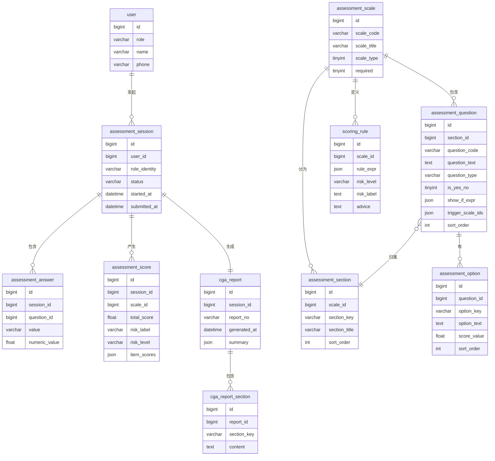

# 老年人预问诊综合评估系统 — 数据库表业务设计

> 文档状态：方案 A（纯前端现状 + 数据库设计文档）
> 本文为后续生产化立项的数据库依据。当前纯前端版本使用 `localStorage` 持久化，尚未接入数据库。

## 1. 业务理解

系统核心是"老人就诊前一次预评估闭环"：

1. 患者/家属/医护在老人正式就诊前启动预问诊
2. 填写基本信息（本人/家属代填角色、年龄、文化程度、居住方式等）
3. 完成 24 题筛查问卷（8 个维度分节，是/否型单选）
4. 系统根据筛查阳性触发深度量表（14 张，按需作答）
5. 自动计分 + 判定风险等级 + 生成《老年综合评估报告》
6. 医护端查看历次评估记录并对比

与参考项目的差异（裁剪掉的业务域）：

| 参考项目业务域 | 本项目是否需要 | 原因 |
|---|---|---|
| AI 对话会话（interaction_session/message/event） | ❌ | 当前为结构化问卷，无 AI 对话 |
| 知情同意宣讲（consent_session） | ❌ | 门诊场景 |
| 分级宣教与 Teach-back | ❌ | 已内置于筛查阳性建议中 |
| 护理任务与调度（care_task） | ❌ | 门诊非住院 |
| 人机对比（assessment_comparison） | ❌ | 无人机双版本 |
| 护士质量评价（quality_review） | ❌ | 门诊无护士独立评估流程 |
| 患者画像与护理计划（patient_profile / nursing_plan） | ❌ | 报告已含风险摘要与建议 |
| 审批与审计（template_approvals / clinical_audit_logs） | 🔜 二期 | 一期量表配置由系统内置 |

## 2. 统一字段规范

所有表统一包含以下字段：

| 字段 | 类型 | 说明 |
|---|---|---|
| `id` | BIGINT PK | 主键 |
| `creator` | VARCHAR(64) | 创建人账号或系统标识 |
| `updator` | VARCHAR(64) | 最后更新人 |
| `create_time` | DATETIME | 创建时间 |
| `update_time` | DATETIME | 更新时间 |
| `deleted` | TINYINT(1) | 逻辑删除，0=未删除，1=已删除 |

临床业务数据原则上不物理删除。量表配置允许版本化替换。

## 3. ER 总览



## 4. 逐表设计

### 4.1 用户域

#### `user` — 用户表

**业务目的**：区分三种角色 — 患者本人、家属代填、医护人员。门诊场景不涉及科室/病区/工号等住院体系字段，保持轻量。

| 字段 | 类型 | 说明 |
|---|---|---|
| `id` | BIGINT PK | |
| `username` | VARCHAR(64) UNIQUE | 登录标识，医护端使用；患者端可匿名（空） |
| `password_hash` | VARCHAR(128) | 医护端 bcrypt 哈希，患者端可为空 |
| `role` | VARCHAR(16) | `patient`（患者/家属代填）、`nurse`（医护）、`admin`（管理员） |
| `real_name` | VARCHAR(64) | 真实姓名 |
| `phone` | VARCHAR(32) | 联系方式 |
| `gender` | TINYINT | 0=女，1=男 |
| `education` | VARCHAR(32) | 文化程度（文盲/小学/初中/高中/大专及以上） |
| `living_arrangement` | VARCHAR(32) | 居住方式（独居/配偶/子女/养老机构） |
| `account_status` | TINYINT | 0=停用，1=启用 |
| `creator` | VARCHAR(64) | |
| `updator` | VARCHAR(64) | |
| `create_time` | DATETIME | |
| `update_time` | DATETIME | |
| `deleted` | TINYINT | |

**业务说明**：
- 患者端预问诊可匿名（`username` 空，`role='patient'`），此时评估记录关联临时 user
- 医护端必须登录（`role='nurse'` 或 `role='admin'`）
- `education` 和 `living_arrangement` 取自 `data.js` 的 `infoFields`

---

### 4.2 量表配置域

当前 `data.js` 中配置的量表：
- **筛查问卷**：8 个分节共 24 题（是/否型），属于一张大量表
- **深度量表**：14 张（9 张必做 + 5 张选做），按 `showIf` 条件条目中 `yesNo` 等属性区分题型

#### `assessment_scale` — 量表主表

**业务目的**：统一管理筛查问卷和深度量表。当前 `data.js` 中 `sections`（筛查）和 `deepScales`（深度）在此表合并。

| 字段 | 类型 | 说明 |
|---|---|---|
| `id` | BIGINT PK | |
| `scale_code` | VARCHAR(16) UNIQUE | 内部编码，如 `screening`（筛查）、`B.1`（ADL）、`B.13`（阿森斯） |
| `scale_title` | VARCHAR(128) | 量表全称 |
| `scale_type` | TINYINT | 1=筛查问卷，2=深度量表 |
| `required` | TINYINT | 1=必做，0=选做（5 张选做量表：vision/hearing/cog/cam/pressure） |
| `version` | VARCHAR(16) | 版本号，如 `WS/T 888-2026-v1` |
| `intro_text` | TEXT | 量表引导语（对应 `data.js` 中各量表 `intro` 字段） |
| `yes_no_mode` | TINYINT | 1=是/否型固定两选项（如 home14），0=普通选项 |
| `creator` | VARCHAR(64) | |
| `updator` | VARCHAR(64) | |
| `create_time` | DATETIME | |
| `update_time` | DATETIME | |
| `deleted` | TINYINT | |

**映射 `data.js`**：

| scale_code | scale_title | scale_type | required | 来源 |
|---|---|---|---|---|
| `screening` | 预问诊筛查问卷（24 题） | 1 | 1 | `sections` 数组 |
| `B.1` | 日常生活能力评估（ADL） | 2 | 1 | `deepScales.adl` |
| `B.2` | 工具性日常能力评估（IADL） | 2 | 1 | `deepScales.iadl` |
| `B.9` | 居家环境安全评估（14 项） | 2 | 1 | `deepScales.home14` |
| `B.11` | 尿失禁评估 | 2 | 1 | `deepScales.incont` |
| `B.12` | 便秘评估 | 2 | 1 | `deepScales.constip` |
| `B.13` | 睡眠评估（阿森斯失眠量表） | 2 | 1 | `deepScales.athens` |
| `B.14` | 疼痛程度评估（0~10 分） | 2 | 1 | `deepScales.painnrs` |
| `B.16` | 压力性损伤风险（Braden 量表） | 2 | 0 | `deepScales.pressure` |
| `B.18` | 营养风险筛查（NRS2002） | 2 | 1 | `deepScales.nrs2002` |
| `B.19` | 微营养评估（MNA-SF） | 2 | 1 | `deepScales.mnasf` |
| `B.4` | 视力评估（五档） | 2 | 0 | `deepScales.vision` |
| `B.6` | 听力评估（五档） | 2 | 0 | `deepScales.hearing` |
| `B.8` | 认知功能简易筛查 | 2 | 0 | `deepScales.cog` |
| `B.21` | 谵妄评估（CAM） | 2 | 0 | `deepScales.cam` |

---

#### `assessment_section` — 量表分节

**业务目的**：仅筛查问卷有分节（8 个维度），深度量表通常不使用（整表一个 section）。

| 字段 | 类型 | 说明 |
|---|---|---|
| `id` | BIGINT PK | |
| `scale_id` | BIGINT FK | 关联 `assessment_scale.id` |
| `section_key` | VARCHAR(32) | 分节唯一标识，如 `emotion`、`sleep`、`fall`、`toilet`、`pain`、`frail`、`nutrition`、`home` |
| `section_title` | VARCHAR(64) | 分节名称 |
| `section_subtitle` | VARCHAR(128) | 副标题（如 `抑郁/焦虑筛查`） |
| `advice_on_positive` | TEXT | 该分节阳性时的系统建议文案 |
| `staff_note` | TEXT | 医护端提示（对应 `staffNoteMap`） |
| `sort_order` | INT | 排序 |
| `creator` / `updator` / `create_time` / `update_time` / `deleted` | — | 统一字段 |

**映射 `data.js`**：

| section_key | section_title | advice_on_positive |
|---|---|---|
| `emotion` | 情绪状态 | "情绪方面需要关注。建议就诊时主动告诉医生..." |
| `sleep` | 睡眠情况 | "睡眠方面需要关注。请配合完成下面的睡眠量表..." |
| `fall` | 跌倒与活动能力 | "跌倒风险需要关注。请配合完成日常生活能力量表..." |
| `toilet` | 大小便情况 | "大小便方面需要关注。请配合完成对应量表..." |
| `pain` | 慢性疼痛 | "疼痛方面需要关注。请指出疼痛的程度..." |
| `frail` | 衰弱状态 | （空，FRAIL 由独立规则判定） |
| `nutrition` | 营养与用药 | "营养与用药方面需要关注。请配合完成营养量表..." |
| `home` | 居家环境安全 | "居家环境存在隐患。请完成居家环境安全量表..." |

---

#### `assessment_question` — 题目

**业务目的**：统一存储筛查问卷题目和深度量表条目。

| 字段 | 类型 | 说明 |
|---|---|---|
| `id` | BIGINT PK | |
| `section_id` | BIGINT FK | 关联 `assessment_section.id`（深度量表无分节时可指向该量表的默认 section） |
| `question_code` | VARCHAR(32) | 题目编码，如 `q1`、`a1`、`n5`、`s1` |
| `question_text` | TEXT | 题干全文 |
| `question_type` | VARCHAR(16) | 题型：`yes_no`（是/否）、`options`（多选项）、`nrs`（数字评定 0~10）、`words`（记忆词展示）、`clock_drawing`（画钟）、`text`（自由文本） |
| `numeric_range_min` | FLOAT | 数值型题的最小值（如 NRS 的 0） |
| `numeric_range_max` | FLOAT | 数值型题的最大值（如 NRS 的 10） |
| `show_if_expr` | JSON | 条件显示表达式，对应 `data.js` 中 `showIf` 函数的逻辑抽象，如 `{"anyAnswered": ["n1","n2","n3","n4"], "compare": "eq", "value": 1}` |
| `trigger_scale_ids` | JSON | 筛查题阳性时触发的深度量表编码数组，如 `["B.1","B.2"]`（对应 `data.js` 中 `t` 字段） |
| `positive_on` | VARCHAR(8) | 哪种回答判定该分节阳性：`yes`（答"是"）、`no`（答"否"，如 home 分节的"否"=安全项不满足）、`any`（任何回答） |
| `sort_order` | INT | 排序 |
| `creator` / `updator` / `create_time` / `update_time` / `deleted` | — | 统一字段 |

**映射 `data.js` 中条件条目示例**：

| question_code | question_text | show_if_expr（对应 `showIf(a)` 函数） |
|---|---|---|
| `n5`（NRS2002） | 营养受损程度 | `{"field":"or","exprs":[{"field":"compare","key":"n1","op":"eq","value":1},{"field":"compare","key":"n2","op":"eq","value":1},{"field":"compare","key":"n3","op":"eq","value":1},{"field":"compare","key":"n4","op":"eq","value":1}]}` |
| `n6`（NRS2002） | 疾病严重程度 | 同上 |

**映射 `data.js` 中触发规则示例**：

| question_code | trigger_scale_ids（对应 `q.t`） | positive_on |
|---|---|---|
| `q5`（睡眠筛查） | `["B.13"]` | `yes` |
| `q7`（跌倒筛查） | `["B.1","B.2"]` | `yes` |
| `q22`（居家筛查） | `["B.9"]` | `no` |
| `q19`（营养筛查） | `["B.18","B.19"]` | `yes` |

---

#### `assessment_option` — 选项

**业务目的**：存储选项文字与对应分值。是/否型可固定两条（是=1/否=0），或由前端隐式处理（当 `question_type='yes_no'` 时前端自动生成）。

| 字段 | 类型 | 说明 |
|---|---|---|
| `id` | BIGINT PK | |
| `question_id` | BIGINT FK | 关联 `assessment_question.id` |
| `option_key` | VARCHAR(16) | 内部标识，如 `opt_1`、`yes`、`no` |
| `option_text` | TEXT | 选项文字（对应 `data.js` 中 `t` 字段） |
| `score_value` | FLOAT | 对应分值（对应 `data.js` 中 `s` 字段） |
| `sort_order` | INT | 排序 |
| `creator` / `updator` / `create_time` / `update_time` / `deleted` | — | 统一字段 |

---

#### `scoring_rule` — 阈值与判定规则

**业务目的**：将 `data.js` 中各量表的 `judge(tot, answers, info)` 函数抽象为可持久化的规则表达式。当前版本使用 JSON 存储规则逻辑，后端评分引擎解析执行。

| 字段 | 类型 | 说明 |
|---|---|---|
| `id` | BIGINT PK | |
| `scale_id` | BIGINT FK | 关联 `assessment_scale.id` |
| `rule_type` | VARCHAR(32) | `threshold`（总分阈值）、`combination`（多条件组合）、`frail_count`（FRAIL 条目计数）、`delirium_boolean`（CAM 布尔组合） |
| `rule_expr` | JSON | 规则表达式（见下方示例） |
| `risk_label` | VARCHAR(64) | 判定结果标签，如 `重度依赖`、`存在睡眠障碍`、`谵妄阳性` |
| `risk_level` | VARCHAR(16) | 风险级别：`ok`、`mild`、`warn`、`danger` |
| `advice` | TEXT | 系统建议文案 |
| `sort_order` | INT | 同量表内规则的优先级（从上到下检查） |
| `creator` / `updator` / `create_time` / `update_time` / `deleted` | — | 统一字段 |

**规则表达式示例**：

```javascript
// ADL (B.1) — threshold 类型
// rule_expr = {"field":"total_score","op":"lte","value":40}
// risk_label = "重度依赖", risk_level = "danger"

// FRAIL — frail_count 类型
// rule_expr = {"field":"yes_count_questions","keys":["q14","q15","q16","q17","q18"],"op":"gte","value":3}
// risk_label = "衰弱", risk_level = "danger"

// CAM (B.21) — delirium_boolean 类型
// rule_expr = {"and":[{"eq":{"key":"d1","value":1}},{"eq":{"key":"d2","value":1}},{"or":[{"eq":{"key":"d3","value":1}},{"eq":{"key":"d4","value":1}}]}]}
// risk_label = "谵妄阳性", risk_level = "danger"

// NRS2002 (B.18) — combination 类型（含年龄加 1 的外部变量）
// rule_expr = {
//   "precondition": {"or":[{"eq":{"key":"n1","value":1}},{"eq":{"key":"n2","value":1}},{"eq":{"key":"n3","value":1}},{"eq":{"key":"n4","value":1}}]},
//   "score_formula": {"sum":["n5","n6"], "add_if":[{"field":"age","op":"gte","value":70,"add":1}]},
//   "checks": [
//     {"field":"formula_result","op":"gte","value":3, "risk_level":"warn", "risk_label":"存在营养风险"},
//     {"field":"formula_result","op":"lt","value":3, "risk_level":"ok", "risk_label":"暂无营养风险"}
//   ]
// }

// 居家环境 (B.9) — bad_items_count 类型
// rule_expr = {"field":"count_zero_answers","key_prefix":"h","checks":[
//   {"op":"gte","value":3, "risk_level":"danger", "risk_label":"明显隐患"},
//   {"op":"gte","value":1, "risk_level":"warn", "risk_label":"轻度隐患"},
//   {"op":"eq","value":0, "risk_level":"ok", "risk_label":"安全"}
// ]}
```

---

### 4.3 评估执行域

#### `assessment_session` — 评估会话

**业务目的**：一次老人就诊前的完整预问诊过程。

| 字段 | 类型 | 说明 |
|---|---|---|
| `id` | BIGINT PK | |
| `user_id` | BIGINT FK | 关联 `user.id`（发起评估的人，可能是患者本人、家属或医护） |
| `role_identity` | VARCHAR(16) | 本次评估的参与身份：`self`（本人）、`family_proxy`（家属代填）、`nurse_administered`（医护执行） |
| `patient_age` | INT | 评估时老人年龄（快照，从 user 的 age 或填写的 age 字段取） |
| `patient_gender` | TINYINT | 评估时性别快照 |
| `patient_education` | VARCHAR(32) | 评估时文化程度快照 |
| `patient_living` | VARCHAR(32) | 评估时居住方式快照 |
| `status` | VARCHAR(16) | `draft`（草稿，进行中）、`submitted`（已提交）、`abandoned`（放弃） |
| `progress_percent` | INT | 完成百分比（0~100） |
| `started_at` | DATETIME | 开始时间 |
| `submitted_at` | DATETIME | 提交时间 |
| `last_saved_at` | DATETIME | 自动保存时间戳 |
| `creator` / `updator` / `create_time` / `update_time` / `deleted` | — | 统一字段 |

**映射 `data.js` 状态**：
- 现有前端 `state.info` → `patient_age/patient_gender/patient_education/patient_living`
- 现有前端 `state.role` → `role_identity`
- 现有前端 `LS_DRAFT_V1` → `status='draft'`
- 现有前端提交后入 `LS_RECORDS_V1` → `status='submitted'`

---

#### `assessment_answer` — 原始回答

**业务目的**：每道题的原始回答快照。一道题一条记录。

| 字段 | 类型 | 说明 |
|---|---|---|
| `id` | BIGINT PK | |
| `session_id` | BIGINT FK | 关联 `assessment_session.id` |
| `question_id` | BIGINT FK | 关联 `assessment_question.id` |
| `value_text` | VARCHAR(64) | 选项 key，如 `yes`、`no`、`opt_3` |
| `numeric_value` | FLOAT | 数值型回答（NRS、选项分值） |
| `answered_at` | DATETIME | 作答时间 |
| `creator` / `updator` / `create_time` / `update_time` / `deleted` | — | 统一字段 |

**映射 `data.js`**：
- `state.answers['q1'] = 'yes'` → `value_text='yes', numeric_value=1`
- `state.deep['nrs2002'].p1 = 7` → 数值型题 `value_text=NULL, numeric_value=7`

---

#### `assessment_score` — 量表得分与风险等级

**业务目的**：每个 session 下每张量表的最终得分、风险等级、逐题得分明细。

| 字段 | 类型 | 说明 |
|---|---|---|
| `id` | BIGINT PK | |
| `session_id` | BIGINT FK | |
| `scale_id` | BIGINT FK | |
| `total_score` | FLOAT | 量表总分 |
| `risk_label` | VARCHAR(64) | 风险标签（来自 scoring_rule） |
| `risk_level` | VARCHAR(16) | `ok` / `mild` / `warn` / `danger` |
| `item_scores` | JSON | 逐题得分明细，如 `{"a1":10,"a2":5,"a3":5,...}` |
| `bad_items` | JSON | 异常条目列表（如 home14 中答"否"的题目 code） |
| `advice` | TEXT | 该量表的系统建议文案 |
| `calculated_at` | DATETIME | 计分时间 |
| `creator` / `updator` / `create_time` / `update_time` / `deleted` | — | 统一字段 |

**FRAIL 特殊说明**：FRAIL 不是独立量表，是筛查问卷第 6 节（frail section）。分数存储为 `scale_id` 指向一个虚拟的 FRAIL scale（`scale_code='frail'`），或直接在 `assessment_score` 中以筛选 section_id 的方式计算。建议创建虚拟 FRAIL scale 记录。

---

### 4.4 报告域

#### `cga_report` — 老年综合评估报告

**业务目的**：每次 session 提交后自动生成一份《老年综合评估报告》的元数据与摘要。

| 字段 | 类型 | 说明 |
|---|---|---|
| `id` | BIGINT PK | |
| `session_id` | BIGINT FK UNIQUE | 一份报告对应一次评估 |
| `report_no` | VARCHAR(64) UNIQUE | 报告编号，如 `CGA-20261028-0001` |
| `generated_at` | DATETIME | 生成时间 |
| `frail_score` | INT | FRAIL 得分（0~5） |
| `frail_label` | VARCHAR(32) | 衰弱判定标签 |
| `positive_sections` | JSON | 筛查阳性分节 key 数组，如 `["sleep","fall","nutrition"]` |
| `triggered_scales` | JSON | 触发的深度量表 code 数组 |
| `summary_text` | TEXT | 报告摘要（供医护快速预览） |
| `pdf_url` | VARCHAR(256) | PDF 导出路径（二期） |
| `creator` / `updator` / `create_time` / `update_time` / `deleted` | — | 统一字段 |

---

#### `cga_report_section` — 报告分节

**业务目的**：保存报告各节渲染后的内容，支持医护端查看。

| 字段 | 类型 | 说明 |
|---|---|---|
| `id` | BIGINT PK | |
| `report_id` | BIGINT FK | |
| `section_key` | VARCHAR(32) | 节标识，如 `basic_info`、`screening_results`、`frail_status`、`deep_scale_B.1`、`risk_summary`、`staff_notes` |
| `section_title` | VARCHAR(64) | 节标题 |
| `content_html` | MEDIUMTEXT | 渲染后的 HTML 片段（供医护端 Web 查看） |
| `content_plain` | MEDIUMTEXT | 纯文本版本（供 PDF/打印） |
| `sort_order` | INT | 报告内顺序 |
| `creator` / `updator` / `create_time` / `update_time` / `deleted` | — | 统一字段 |

**建议的 section_key 列表**：

| section_key | 内容 |
|---|---|
| `cover` | 封面（老人姓名、年龄、评估日期、报告编号） |
| `basic_info` | 基本信息 |
| `screening_results` | 24 题筛查逐节结果 |
| `frail_status` | 衰弱状态（FRAIL 得分 + 判定） |
| `deep_scale_{code}` | 各深度量表得分与建议，如 `deep_scale_B.1`、`deep_scale_B.13` |
| `home_safety` | 居家环境逐项隐患清单（如有） |
| `risk_summary` | 总体风险摘要与医护关注事项 |
| `staff_notes` | 医护提示（来自 `staffNoteMap`） |

## 5. 关键设计决策

### 5.1 条件条目如何存储？

NRS2002 的 `n5`/`n6` 有 `showIf` 函数：当初筛 4 题任一答"是"时才显示。数据库中用 `assessment_question.show_if_expr` 存储 JSON 表达式，后端计分引擎和前端渲染器都解析这个 JSON 来判定显隐。

**选择理由**：用函数存 JSON 而不是 Python 函数字符串，便于跨语言复用（纯前端版也可以用同一套 JSON 表达式执行器）。

### 5.2 阈值规则如何抽象？

参考项目把 `judge` 函数（含总分阈值、组合判定、布尔逻辑、外部变量加 1）全部硬编码在 `data.js` 的 JavaScript 函数里。生产化版本需要统一抽象成可存库的 JSON 规则表达式。

当前 `scoring_rule.rule_expr` 用 JSON 表达 4 种常见模式：
- `threshold`：总分 vs 阈值（ADL、IADL、阿森斯、MNA-SF、视力、听力）
- `combination`：多变量组合 + 外部变量（NRS2002 的年龄加 1）
- `boolean_combo`：条目间 AND/OR 布尔组合（CAM 谵妄判定）
- `count_bad`：计算异常条目数 vs 阈值（居家环境、FRAIL）

**已知不完美**：某些量表的 `judge` 有 `advice` 字段个性化文案，目前存于 `scoring_rule.advice` 中，能覆盖。但将来如果出现更复杂的评分公式（如带权重、交互项），需要扩展 `rule_expr` 结构。

### 5.3 触发关系如何存？

筛查题 → 深度量表的触发关系存于 `assessment_question.trigger_scale_ids`。是/否型题在 `positive_on` 中标识哪种回答触发。

特殊：home 分节的筛查题（q22/q23/q24）是"答否=存在隐患=触发"，`positive_on='no'`。其他分节都是 `positive_on='yes'`。

### 5.4 FRAIL 作为独立量表还是 section？

当前 `data.js` 中 FRAIL 是筛查问卷的一个 section（第 6 节），5 道是/否题，`yes` 计数 ≥3 判定衰弱。

**决策**：在 `assessment_scale` 中创建一条虚拟记录 `scale_code='frail'`，`scale_type=3`（非筛查非深度，是 section 内的聚合评分）。这样 `assessment_score` 表可以统一存储其得分，不需要特殊处理。

### 5.5 PostgreSQL vs MySQL？

参考项目用 PostgreSQL。PostgreSQL 的 JSONB、CTE、丰富统计函数比 MySQL 更适合医疗数据查询和科研分析。**建议生产化选 PostgreSQL 15+**。

### 5.6 当前纯前端版本的映射

当前 `localStorage` 中的三份数据可以一键迁移到数据库：

| localStorage key | 目标表 |
|---|---|
| `CGA_DRAFT_V1` | `assessment_session` + `assessment_answer` + `user`（临时用户） |
| `CGA_RECORDS_V1` | `assessment_session`（status=submitted） + `assessment_answer` + `assessment_score` + `cga_report` + `cga_report_section` |
| `CGA_PREF_V1` | 不入库（仅用户偏好：字号、语音开关） |
