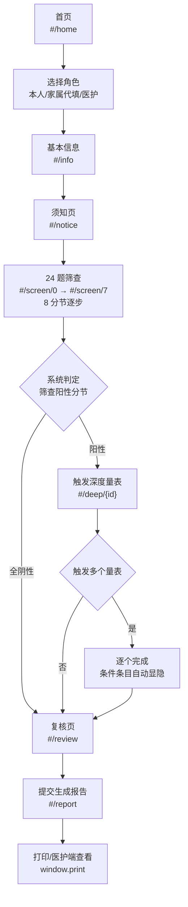
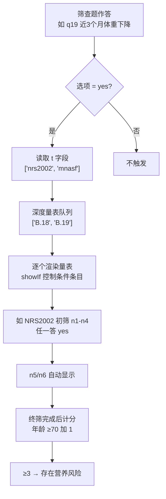
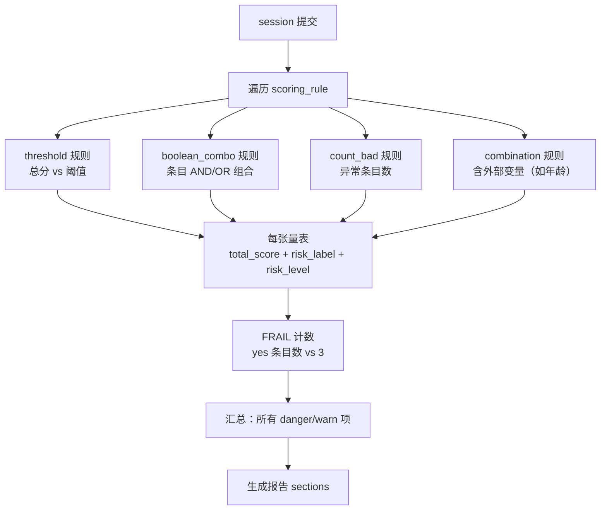
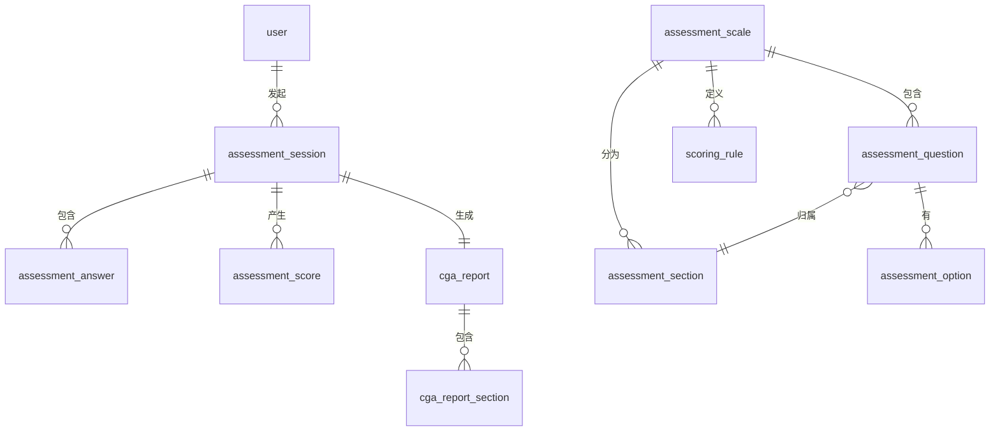

# 老年人预问诊综合评估系统 — 项目构想总需求

## 1. 项目定位

本项目面向**门诊预问诊场景**：在 65 岁以上老人正式就诊前，由患者本人、家属或陪同人员在候诊区或门诊自助设备上完成一次老年人综合评估（CGA），系统自动计分判定风险，生成《老年综合评估报告》供接诊医生快速了解老人状况、重点关注项和健康建议。

与参考项目的定位差异：

| 维度 | 参考项目（住院场景） | 本项目（门诊预问诊） |
|---|---|---|
| 触发时机 | 入院时（病房里） | 就诊前（候诊区/自助设备） |
| 目标人群 | 住院患者 | 65+ 门诊老人 |
| 采集人员 | 护士/AI 对话 | 患者/家属代填为主 |
| 核心输出 | AI+护士双版本评估对比、护理计划、宣教 | 一份预评估报告、医护关注事项 |
| 是否需要 AI 对话 | 是（CICARE 问询） | 否（结构化问卷 + 语音读题） |
| 是否需要后端 | 是（PostgreSQL + Redis + SSE） | 一期否（纯前端 + localStorage），二期是 |

## 2. 资料范围与标准依据

### 2.1 核心标准

| 资料 | 来源 | 系统用途 |
|---|---|---|
| WS/T 888—2026 《医疗机构老年综合评估技术操作标准》 | 卫生健康委员会 | 24 题筛查 + 14 张深度量表 + 阈值判定的唯一依据 |
| 项目需求原文 | `medical/_docx_原文.txt`（187 段） | 24 题原文、量表条目、阈值规则映射 |

### 2.2 现有数据结构

| 数据 | 文件 | 规模 |
|---|---|---|
| 24 题筛查问卷 | `medical/js/data.js` → `sections` 数组 | 8 个分节 |
| 14 张深度量表 | `medical/js/data.js` → `deepScales` 对象 | 9 张必做 + 5 张选做 |
| 阈值判定规则 | `medical/js/data.js` → 各量表 `judge` 函数 | JS 硬编码 + `frailJudge` 独立函数 |
| 阳性触发规则 | `medical/js/data.js` → `t` 字段 | 筛查题 → 深度量表 |
| 医护提示 | `medical/js/data.js` → `staffNoteMap` | 分节阳性时的医护端提示文案 |

### 2.3 已实现功能

| 功能模块 | 状态 | 说明 |
|---|---|---|
| 首页与角色选择 | ✅ | 本人 / 家属代填 / 医护 |
| 基本信息 | ✅ | 年龄、性别、文化程度、居住方式 |
| 24 题筛查向导 | ✅ | 8 分节逐步答题、自动保存 |
| 语音读题 | ✅ | 浏览器 speechSynthesis zh-CN |
| 阳性自动触发深度量表 | ✅ | 根据 `t` 字段和 `positive_on` 判定 |
| NRS2002 条件条目 | ✅ | 初筛任"是"→ 显示终筛（display:none 控制） |
| 居家环境是/否型 | ✅ | 自动渲染固定两选项 |
| 各量表自动计分与风险判定 | ✅ | 总分阈值 / 布尔组合 / 外部变量加 1 |
| 报告生成 | ✅ | 分节渲染，含风险等级色块 |
| 打印 | ✅ | `window.print` + `@media print` |
| 医护端记录列表 | ✅ | localStorage 中 `CGA_RECORDS_V1` |
| 历次对比 | ✅ | 医护端可任选两次评估对比 |
| 自动保存续答 | ✅ | `CGA_DRAFT_V1` + 中断恢复提示 |
| 字号三档 | ✅ | 20px / 23px / 26px 适老化 |
| 测试 | ✅ | `tests/medical-flow.test.js` 76 项断言 |

## 3. 用户角色

| 角色 | 主要能力 | 使用端 |
|---|---|---|
| 患者本人 | 独立完成预问诊、听读题目、查看报告 | 预问诊端（自助设备/手机） |
| 家属/陪同 | 代老人填写预问诊、核对信息 | 预问诊端 |
| 医护人员 | 查看历次评估记录、两次评估对比、重点关注事项 | 医护端（Web） |
| 系统管理员 | （二期）量表配置管理、用户权限、版本发布 | 管理后台 |

**一期 MVP 角色覆盖**：患者本人 + 家属代填 + 医护人员（医护端记录列表与对比）。管理员角色计划二期引入。

## 4. 总体架构

```mermaid
flowchart TD
    subgraph 一期：纯前端现状
        A["预问诊端<br/>（老人/家属/医护代填）"] --> B["hash 路由状态机<br/>app.js"]
        B --> C["配置数据层<br/>data.js（量表/阈值/触发规则）"]
        B --> D["localStorage 持久化<br/>草稿/记录/偏好"]
        B --> E["语音读题<br/>speechSynthesis"]
        B --> F["报告生成与打印<br/>window.print"]
    end

    subgraph 二期：前后端分离
        A2["预问诊端"] --> B2["前端 SPA<br/>Next.js/Vue"]
        G["医护端（Web）"] --> B2
        H["管理后台"] --> B2
        B2 --> I["FastAPI 后端<br/>量表配置下发、计分服务、报告持久化"]
        I --> J["PostgreSQL<br/>10 张核心表"]
        I --> K["评分引擎<br/>JSON 规则表达式解析"]
        I --> L["PDF/Word 导出服务"]
    end

    style A fill:#e1f5fe
    style B fill:#fff3e0
    style C fill:#e8f5e9
    style D fill:#fce4ec
    style 一期：纯前端现状 fill:#f5f5f5
```

## 5. 核心模块设计

### 5.1 24 题预问诊筛查模块

8 个分节，覆盖老年人最常见的临床风险维度：

| 分节 | 编码 | 题数 | 筛查目标 | 阳性触发量表 |
|---|---|---|---|---|
| 情绪状态 | emotion | 4 | 抑郁/焦虑（PHQ/GAD 简化版） | —（直接提示就医） |
| 睡眠情况 | sleep | 2 | 失眠筛查 | B.13 阿森斯 |
| 跌倒与活动 | fall | 4 | 跌倒风险 | B.1 ADL + B.2 IADL |
| 大小便 | toilet | 2 | 尿失禁/便秘 | B.11 + B.12 |
| 慢性疼痛 | pain | 1 | 慢性疼痛 | B.14 NRS |
| 衰弱状态 | frail | 5 | FRAIL 衰弱判定（≥3 衰弱） | —（直接判定） |
| 营养与用药 | nutrition | 3 | 营养风险/多重用药 | B.18 NRS2002 + B.19 MNA-SF |
| 居家环境 | home | 3 | 居家安全隐患 | B.9 居家环境 14 项 |

**交互设计**：分节逐步展示（一次一节），是/否单选按钮，选中即自动保存，支持语音朗读。

### 5.2 深度量表按需作答模块

9 张必做 + 5 张选做。根据筛查阳性自动触发。

| 量表 | 编码 | 必做/选做 | 阈值规则 | 题型 |
|---|---|---|---|---|
| ADL 日常生活能力 | B.1 | 必做 | ≤40 重度、≤60 中度、<100 轻度 | 多选项分值 |
| IADL 工具性日常 | B.2 | 必做 | ≥8 正常、≥6 轻度、≥3 中度、<3 严重 | 多选项分值 |
| 阿森斯失眠 | B.13 | 必做 | ≥6 存在障碍、≥4 可能障碍 | 多选项分值 |
| 疼痛 NRS | B.14 | 必做 | 0 无痛、≤3 轻度、≤6 中度、>6 重度 | NRS 0-10 |
| 尿失禁 | B.11 | 必做 | ≤5 轻度、≤10 中度、>10 重度 | 多选项 + NRS |
| 便秘 | B.12 | 必做 | c1=1 or c2≥2 or c3≥2 → 存在便秘 | 多选项 + 布尔组合 |
| NRS2002 营养风险 | B.18 | 必做 | 初筛任一"是"→ 终筛 n5+n6+(≥70加1) ≥3 风险 | 条件条目 + 外部变量 |
| MNA-SF 微营养 | B.19 | 必做 | ≤11 营养不良风险 | 多选项分值 |
| 居家环境 14 项 | B.9 | 必做 | badItems≥3 明显、≥1 轻度 | 是/否型（答否=隐患） |
| 视力 | B.4 | 选做 | 4 正常、3 低视力、1-2 盲、0 全盲 | 多选项 |
| 听力 | B.6 | 选做 | 4 正常、3 下降、1-2 障碍、0 失聪 | 多选项 |
| 认知简易 | B.8 | 选做 | ≤2 认知障碍筛查阳性 | 记忆词 + 画钟 |
| CAM 谵妄 | B.21 | 选做 | d1+d2 + (d3 or d4) → 谵妄阳性 | 布尔组合 |
| Braden 压疮 | B.16 | 选做 | ≤9 极高危、≤12 高危、≤14 中危 | 多选项分值 |

### 5.3 自动计分与风险判定模块

**核心能力**：
- 逐量表独立计分（总分累加）
- 阈值判定（总分 vs 固定阈值）
- 布尔组合判定（CAM、居家环境 bad 条目数）
- 条件公式（NRS2002 含年龄加 1 的外部变量）
- FRAIL 衰弱计数（yes 条目 ≥3）
- 风险等级标准化（ok / mild / warn / danger）

**当前实现**：`medical/js/app.js` 中 `scaleResult(id)` 和 `computeAll()` 函数驱动。各量表阈值逻辑硬编码在 `data.js` 各量表的 `judge(tot, answers, info)` 函数中。

**生产化路径**：参考 `docs/sql/数据库表业务设计.md` 中的 `scoring_rule` 表设计，将 `judge` 函数抽象为 JSON 规则表达式。

### 5.4 《老年综合评估报告》生成模块

**报告结构**：

| 节 | 内容 |
|---|---|
| 封面 | 老人姓名、年龄、评估日期、报告编号 |
| 基本信息 | 年龄、性别、文化程度、居住方式、代填角色 |
| 筛查结果 | 8 分节逐节结果（是/否数量、是否阳性、建议） |
| 衰弱状态 | FRAIL 得分（0~5）、衰弱判定、建议 |
| 深度量表结果 | 触发的每张量表得分 + 风险标签 + 等级色块 + 系统建议 |
| 居家环境 | 14 项逐项隐患清单（仅答"否"的项目列出） |
| 医护关注事项 | 汇总所有 danger/warn 等级项 + staffNoteMap 医护提示 |
| 风险摘要 | 一句话总结（如："存在睡眠障碍+跌倒风险+营养风险，建议进一步专科评估"） |

**输出方式**：
- 浏览器 `window.print` + `@media print` 样式（一期，可打印为 PDF）
- 二期：后端生成 PDF 文件供下载 / 邮件发送

### 5.5 医护端记录管理模块

**一期已实现**：
- 评估记录列表（从 `CGA_RECORDS_V1` 读取，按时间倒序）
- 任选两次评估对比（差异比对：哪些分节阳性变化、哪些量表风险等级变化）

**二期扩展**：
- 登录鉴权（医护账号）
- 评估报告 PDF 下载
- 按日期范围、风险等级筛选
- 批量导出
- 与 HIS 对接（读取患者基本信息）

### 5.6 量表配置管理模块

**一期**：所有量表、选项、阈值、触发规则硬编码在 `medical/js/data.js` 中。修改规则需要开发人员改 JS 代码、重新发布前端。

**二期**：参考 `docs/sql/数据库表业务设计.md` 中的 5 张配置表（`assessment_scale` / `assessment_section` / `assessment_question` / `assessment_option` / `scoring_rule`），量表配置存于 PostgreSQL，后端提供 JSON 接口下发。

## 6. 核心业务流程

### 6.1 预问诊向导流程



### 6.2 深度量表触发与条件条目流程



### 6.3 计分与风险汇总流程



## 7. 数据模型

数据库设计详见独立文档 `docs/sql/数据库表业务设计.md`。以下为概览：

**4 大业务域、11 张核心表**：

| 业务域 | 表名 | 用途 |
|---|---|---|
| 用户域 | `user` | 患者/家属/医护/管理员 |
| 量表配置域 | `assessment_scale` | 量表主表（筛查 + 14 张深度） |
| | `assessment_section` | 筛查问卷分节（8 维度） |
| | `assessment_question` | 题目（含条件显示表达式、触发量表数组） |
| | `assessment_option` | 选项 + 分值 |
| | `scoring_rule` | 阈值判定规则（JSON 表达式） |
| 评估执行域 | `assessment_session` | 一次预问诊会话 |
| | `assessment_answer` | 每题原始回答 |
| | `assessment_score` | 各量表得分 + 风险等级 |
| 报告域 | `cga_report` | 报告元数据 + 摘要 |
| | `cga_report_section` | 报告分节内容 |

**ER 总览**（简化版）：



## 8. AI 能力设计

**一期（方案 A）**：不引入 AI。语音读题使用浏览器原生 `speechSynthesis` API（zh-CN），非 AI 生成。

**二期可能引入的 AI 能力**：

| 能力 | 设计边界 | 替代方案 |
|---|---|---|
| 问题口语化改写 | 将量表题目转为老人易懂的日常表达，必须绑定原题 ID | 话术模板（非 AI） |
| 语音问询引导 | 类似参考项目的 CICARE 开场/引导，但仍是结构化问卷 | 固定话术 + TTS |
| 异常自动转人工 | 检测到老人回答矛盾、多次中断、情绪异常时提示家属或医护 | 规则触发 + 阈值（非 AI 语义理解） |
| 宣教建议生成 | 基于风险等级推荐健康教育内容 | 规则匹配知识库（非 AI 自由生成） |

**不建议 AI 直接做**（一期不引入，二期也不建议）：

| 事项 | 原因 |
|---|---|
| 独立诊断 | 涉及医疗责任，应由医生判断 |
| 修改量表阈值 | 量表阈值来自 WS/T 888 行业标准，不可由 AI 自行调整 |
| 自由生成宣教内容 | 医疗内容需临床审核 |
| 隐式改变评分逻辑 | 评分必须可追溯、可解释 |

## 9. 安全、合规与质控设计

| 方向 | 一期（纯前端） | 二期（后端化） |
|---|---|---|
| 患者隐私 | localStorage 中本地存储，不上传 | 身份证/手机号加密存储，接口脱敏返回 |
| 数据安全 | 仅限本地浏览器访问 | HTTPS 传输 + 数据库加密列 |
| 权限控制 | 无显式登录（医护端和预问诊端同一浏览器） | Role-Based：患者/家属/医护/管理员不同菜单与接口 |
| 版本追溯 | 量表配置修改需重新发前端 | 量表配置版本化（`assessment_scale.version`），每次评估快照所用版本 |
| 审计日志 | 无 | 所有配置修改、报告导出、医护登录操作记录审计日志 |
| 医疗责任边界 | 报告标注"预评估参考，不作为临床诊断" | 报告显式标注参考性质，医护确认签字后才作为病历组成 |
| 转人工机制 | 阳性分节自动标注医护关注事项 | 后端风险等级 ≥ danger 时自动推送医护端告警 |
| 真实患者数据保护 | 禁止提交版本控制 | 生产数据库与演示数据隔离，真实数据不得备份到 Git |

## 10. 一期 MVP 范围（已实现）

| 模块 | 范围 | 状态 |
|---|---|---|
| 预问诊端 | 首页 / 角色选择 / 基本信息 / 须知 / 24 题筛查 / 深度量表按需触发 / 自动计分 / 报告 / 打印 | ✅ 已实现 |
| 深度量表 | 9 张必做 + 5 张选做，条件条目自动显隐 | ✅ 已实现 |
| 语音读题 | 浏览器原生 speechSynthesis，可开关 | ✅ 已实现 |
| 字号三档 | 20 / 23 / 26 px 适老化 | ✅ 已实现 |
| 自动保存续答 | localStorage 草稿 + 中断恢复 | ✅ 已实现 |
| 医护端 | 评估记录列表 + 任选两次对比 | ✅ 已实现 |
| 测试 | 76 项断言覆盖数据完整性、阈值边界、完整流程、对比、续答 | ✅ 已实现 |
| 数据库 | 无（localStorage 演示级） | ⏳ 已设计（见 docs/sql/） |
| 后端 | 无 | ⏳ 待立项 |

**一期已验证的关键风险**：

| 风险项 | 验证结果 |
|---|---|
| NRS2002 条件条目显隐 | ✅ display:none 控制，作答后不重建 DOM |
| 居家环境是/否型无 options | ✅ yesNo 分支渲染固定两选项 |
| 条件条目终筛计分明细 | ✅ 终筛 n5+n6+(≥70加1) 正确计入总分 |
| CAM 布尔组合判定 | ✅ d1+d2+(d3 or d4) 逻辑正确 |
| FRAIL 计数 vs 3 阈值 | ✅ yes 条目数正确计数 |
| 历次对比 | ✅ 两记录分节逐一 diff 标记 |

## 11. 二期与后续扩展

| 阶段 | 目标 | 前置条件 |
|---|---|---|
| **二期** | 引入 FastAPI 后端 + PostgreSQL，量表配置/计分/报告持久化 | 立项 + 后端开发环境搭建 + PostgreSQL |
| **二期** | 医护端登录鉴权 + 管理后台（量表配置版本化） | 后端框架就绪 |
| **二期** | 报告 PDF/Word 后端生成导出 | 后端 PDF 服务（reportlab/wkhtmltopdf） |
| **二期** | 语音交互引导（固定话术 + TTS 增强） | 可选 |
| **三期** | 与 HIS/EMR 对接：读取患者基本信息、回写评估结果到病历 | HIS 厂商配合 + 接口开发 |
| **三期** | 批量导出科研数据（脱敏） | 权限与脱敏逻辑 |
| **四期** | 预问诊自助终端部署（门诊分诊台 iPad/自助机） | 硬件选型 + 场地部署 |
| **五期** | 基于真实数据优化阈值（如居家环境隐患项权重、量表截断点） | 一定量的真实评估数据积累 |

## 12. 待确认问题

| 问题 | 影响 | 建议 |
|---|---|---|
| 是否引入 AI 对话能力？ | 影响架构选择（纯前端 vs 前后端 + LLM） | 一期不引入。若引入，作为二期独立立项 |
| 数据库选型：PostgreSQL vs MySQL？ | 影响后端框架选型和 JSON 处理能力 | 参考项目用 PostgreSQL，本项目建议 PostgreSQL 15+ |
| 医护端是否需要显式登录？ | 影响安全设计（Session/JWT vs 无鉴权） | 二期后端化时加入 |
| 报告 PDF 导出放在前端还是后端？ | 前端 window.print 够用但 PDF 样式不可控；后端 PDF 服务需额外依赖 | 一期用 window.print，二期上后端 PDF |
| 是否需要患者手机号/身份证识别？ | 影响 session 持久化和跨设备续答 | 一期匿名，二期可选身份绑定 |
| 量表配置变更流程？ | 影响 `scoring_rule` 表的审批机制 | 二期管理后台引入版本化 + 审批流 |

## 13. 建议下一步

1. **确认方案 A 并交付文档**：数据库设计文档（`docs/sql/数据库表业务设计.md`）+ 项目构想总需求（`docs/项目构想总需求.md`），已生成。
2. **更新 AGENTS.md**：补充数据模型和文档链接。
3. **Git 提交**：创建 `docs/` 和 `docs/sql/` 目录，提交 `docs: 补充项目构想总需求与数据库设计`。
4. **（可选）发布远程**：如需推送到远程仓库，请提供 Git 仓库 URL。
5. **（可选）二期立项评估**：若决定后端化，按 AGENTS.md 约定 6 重新讨论技术栈（FastAPI 后端 + PostgreSQL）并写独立计划文档。
